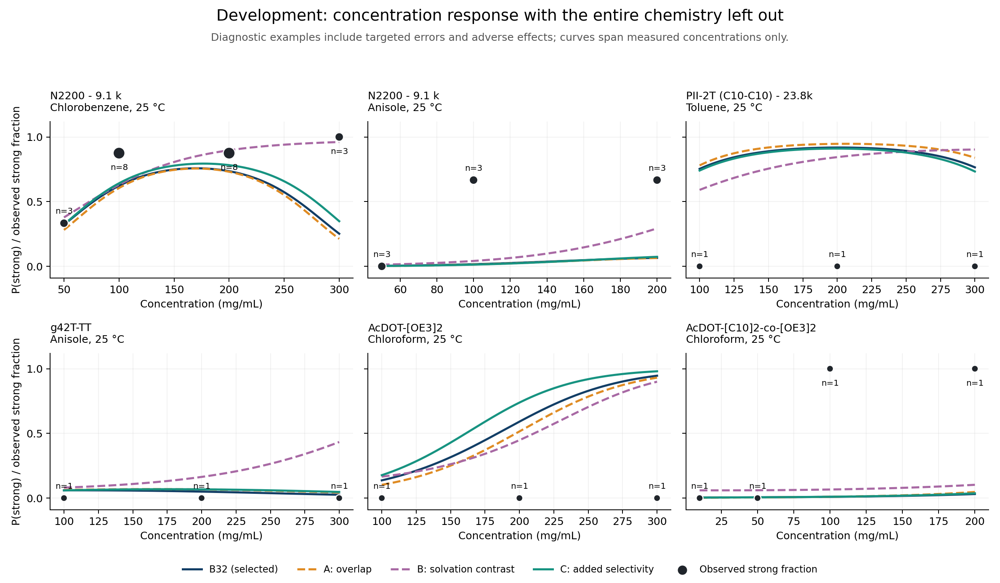
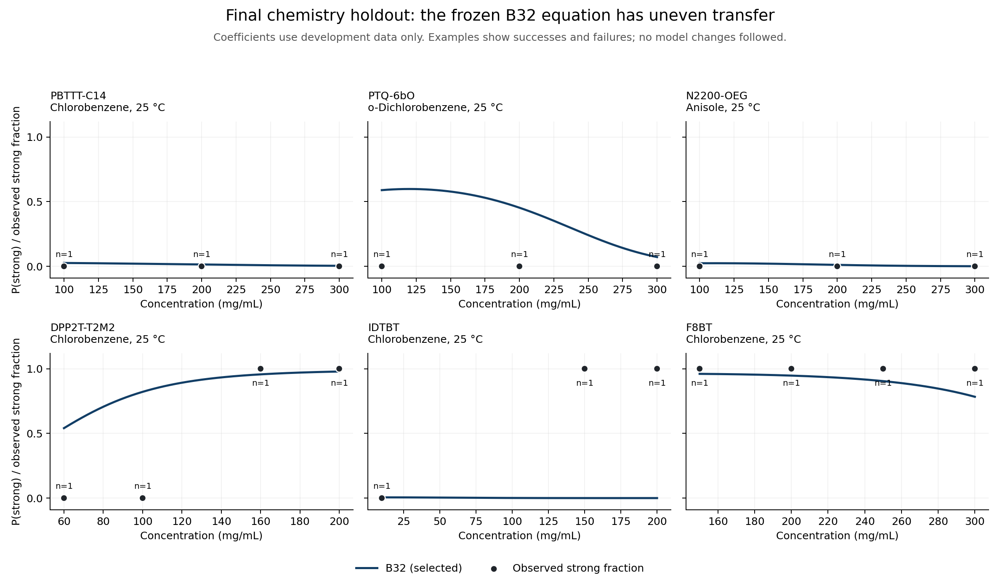

# ChiralML equation-repair experiment: complete reading document

This document combines the scientific report, full fitted equation, chronological
proposal/evaluation log, and numerical verification for one exploratory study.
It is generated from the original artifacts without changing the scientific results.

**Conclusion:** retain the original five-term B32 structure. Three reasoning-driven
edits failed to provide convincing transfer improvement. The final coefficients
use all 773 observations; the final chemistry-holdout assessment used only the
earlier development-fitted coefficients. Discovery leakage and imperfect blindness
to one published literature example are explicitly documented below.

All following sections are study content. The complete code, workbook, predictions,
figures and source provenance are available through the linked repository artifacts.

[Experiment directory](https://github.com/joelpaulson/ChiralML/tree/astra-equation-repair/experiments/astra_equation_repair) · [Reproduction instructions](https://github.com/joelpaulson/ChiralML/blob/astra-equation-repair/experiments/astra_equation_repair/README.md) · [Raw reading document](https://raw.githubusercontent.com/joelpaulson/ChiralML/astra-equation-repair/experiments/astra_equation_repair/CHATGPT_READING.md)


---

Source: [REPORT.md](https://github.com/joelpaulson/ChiralML/blob/astra-equation-repair/experiments/astra_equation_repair/REPORT.md)

# Reasoning-driven equation repair: exploratory negative result

**The three allowed structural interventions did not produce a convincing improvement over B32.** We retained its five-term structure using development data only, froze that decision, evaluated the chemistry holdout once, and refitted the retained structure on all 773 observations. The complete fitted expression and units are in [FINAL_EQUATION.md](https://github.com/joelpaulson/ChiralML/blob/astra-equation-repair/experiments/astra_equation_repair/FINAL_EQUATION.md).

The inspiration was reasoning-guided intervention in an existing learned model. This study edits symbolic structure and then numerically fits coefficients; it is not direct neural-weight editing without optimization, nor a reproduction of the experiments in the [weight-space-programming article](https://rikiyat.github.io/blog/weight-space-programming/). No symbolic search, equation generator, hyperparameter grid, or polymer-specific offsets were used.

## Protocol and scope

The target is `abs_g_factor >= 0.001`. Before reading outcome rows, we split the 59 chemistry groups with NumPy `default_rng(20261104)`: randomly permute sorted group codes and reserve the first `ceil(0.2*59)=12`. Development contains **47 chemistries, 631 rows and 251 positives**; final holdout contains **12 chemistries, 142 rows and 20 positives**. Different observation counts per chemistry mean a 20.34% chemistry split holds aside 18.37% of rows. No stratification, seed selection, or redraw was performed.

Chemistries use the existing `chiral_sr.data.chemistry` function: identical polymer-constant descriptors, excluding Mn, Mw, PDI, temperature and concentration. It rounds floating descriptors to eight decimals, represents missing values consistently, concatenates them, and factorizes in first-observation order. The 61 defining columns are listed in `split.json`; the complete label-free mapping is in `split_manifest.csv`. This is a descriptor-defined equivalence, not a hand-curated claim about every constitutional isomer. It groups molecular-weight variants of N2200, PII-2T, PE2-biOE2OE3 and the ladder polymers. Every polymer name belongs wholly to one partition. No solvent or outcome descriptor appears in the chemistry key.

Held-aside codes: 4, 13, 15, 16, 19, 20, 32, 36, 48, 49, 57, 58, corresponding to PBTTT-C14, PTQ-2bO2, PTQ-6bO, PTQ-6O, N2200-OEG, p(C3NDI-T), DPP2T-T2M2, PyDPP-2T(C8C10), PM7 2ET2, TPT(alkyl)-E, IDTBT and F8BT. Development routines skip held-out worksheet rows when parsing metadata outcomes. `selection.json` was saved before `final_started.json`; the registry and fold definitions are hashed.

Each equation uses the repository's SyMANTIC `fit_glm` through `laws.fit`. Terms are centered and divided by their **training-fold sample SD**, then fitted with summed logistic loss plus `0.5*0.1*sum(beta²)`; the intercept is unpenalized. No class weighting, coefficient-sign constraints, missing-value imputation, offsets, or regularization tuning were used. All model terms are finite. First-order optimality was checked for every fit.

Primary assessment: **47-fold leave-one-chemistry-out (LOCO)**, with pooled out-of-fold predictions. Complement: the repository's **20 repetitions of five-fold stratified polymer-name–solvent grouped CV**, seeds 1000–1019, using 173 groups. The latter can share a chemistry across train and test, including molecular-weight variants, and is a weaker transfer test. All four models use exactly the same saved folds. Pooled scores weight observations; we also report equal-chemistry mean loss. Per-chemistry AP and AUC are undefined for single-class chemistries and are omitted there, not set to zero. Only 26 of 47 development chemistries have both classes.

## What was changed, and what feedback taught us

With notation defined in the final equation, B32 is

`f = b0 + b1(S−B)cR + b2HUFbb + b3c²Fbb/Q + b4(S−B)UB + b5cMB/E`.

At fixed descriptors this is quadratic in concentration. Its curvature changes sign at Fbb=0, which means 1 mol/L fragment solubility rather than a known assembly transition. Its positive linear Mn interaction is also not a universal overlap law. The development fit predicts decreasing probability at 244/631 observed conditions and misses low-M N2200/anisole positives while overpredicting several PII-2T conditions. These were development diagnostics, not evidence that all nonmonotonicity is unphysical.

Every proposal and expected behavior was recorded in `EXPERIMENT_LOG.md` before its first fit. The entire budget was three proposals:

| Model | Structural intervention | Terms | Feedback |
|---|---|---:|---|
| A_overlap | Replace cMB/E with c sqrt(M/1000) B/E | 5 | Ideal-coil overlap scaling weakened MW dependence but did not repair N2200 and worsened LOCO performance. |
| B_contrast | Restore original Mn term; replace c²Fbb/Q with c²(Fbb−Fmono)/Q | 5 | A relative-solubility zero is more interpretable, but removing absolute backbone solubility lost substantial information. |
| C_selectivity | Restore all B32 terms; add c(Fmono−Fbb) | 6 | The expected negative interaction appeared, but predictive gains were too small and inconsistent to justify the added term. |

A's overlap analogy assumes ideal-coil size scaling and need not apply to semiflexible chains in concentrated solutions. B tests solvent selectivity as a substitute for absolute fragment solubility. C instead treats selectivity as a leading-order concentration correction. Neither solubility descriptor is a measured polymer assembly free energy. These are distinct, bounded scientific hypotheses, not claims of derived physical laws.

## Development results

Higher AP/AUC and lower loss are better. Complementary scores are means of 20 pooled-OOF repeats, not scores of predictions averaged across repeats.

| Model | LOCO AP | LOCO AUC | LOCO log loss | Equal-chemistry loss | Pair-CV AP | Pair-CV AUC | Pair-CV log loss |
|---|---:|---:|---:|---:|---:|---:|---:|
| **B32 (selected)** | 0.786868 | 0.863834 | **0.447150** | **0.381987** | 0.792941 | 0.869314 | **0.439066** |
| A_overlap | 0.777791 | 0.860951 | 0.454579 | 0.384271 | 0.791480 | 0.870571 | 0.440238 |
| B_contrast | 0.693110 | 0.800068 | 0.530354 | 0.438790 | 0.719983 | 0.817950 | 0.506435 |
| C_selectivity | 0.788254 | **0.865218** | 0.448768 | 0.394483 | **0.794184** | **0.871085** | 0.441296 |

Pair-CV AP standard deviations across repeats are respectively 0.010969, 0.011163, 0.011057 and 0.011763; loss SDs are 0.011495, 0.010552, 0.009046 and 0.012627. Repeats share observations and are not independent experimental replicates. Equal-weight AP across the 26 mixed-class chemistries is 0.86543, 0.86633, 0.83674 and 0.86539 respectively; corresponding AUCs are 0.86089, 0.86114, 0.83566 and 0.86038. These conditional averages exclude single-class chemistries and cannot replace all-chemistry loss.

Paired percentile intervals below resample entire development chemistries 2,000 times (seed 20261105), using the same fixed OOF predictions for each model. They describe sensitivity to chemistry composition, **not** fully nested selection-adjusted generalization uncertainty.

| Candidate minus B32 | Δ LOCO AP [95% interval] | Δ LOCO loss [95% interval] | Chemistries with lower loss |
|---|---|---|---:|
| A | −0.00908 [−0.03537, 0.01471] | +0.00743 [−0.01128, 0.02400] | 25/47 |
| B | −0.09376 [−0.15921, −0.03844] | +0.08320 [0.03929, 0.12798] | 13/47 |
| C | +0.00139 [−0.02208, 0.01812] | +0.00162 [−0.01395, 0.01839] | 32/47 |

C's chemistry-median loss change was −0.00659, and its selectivity coefficient was negative in every LOCO fit (range −0.004304 to −0.001171). But its larger adverse changes included AcDOT-[OE3]2 (+0.500 loss), D18 (+0.266), ProDOT(OE3)-co-ProDOT(EtHx) (+0.213) and PE2-biOE2 (+0.204). Its equal-chemistry loss worsened by 0.01250. Complementary AP improved in 15/20 repeats, while loss improved in only 4/20. The small pooled Brier improvement (0.146956 to 0.146918) likewise provides little support for added complexity. Training AP improved from 0.81920 to 0.82510, which is insufficient evidence of transfer.

**Selection: retain B32.** It has one fewer term than C, better pooled and macro LOCO log loss, and essentially tied ranking performance. This decision was frozen before final holdout evaluation. There was no holdout-based model or threshold selection.



Figure 1 uses the fit that excludes the entire displayed chemistry. Points are the measured fraction with |g|≥10⁻³ at exactly matched polymer, solvent, temperature and concentration; labels show the replicate count. Curves cover measured concentration ranges. These deliberately diagnostic examples show targeted failures and adverse effects, not a representative random sample. No uncertainty bands are asserted for the small and correlated replicate counts. Raw g factors remain available in the prediction CSV.

## Final held-aside assessment

The selected model **is B32**, so these two requested roles have identical predictions and are evaluated once, not treated as two independent models. Rejected A, B and C were not evaluated on the holdout.

| Frozen development fit | AP | ROC-AUC | Log loss | Brier |
|---|---:|---:|---:|---:|
| Original B32 = selected structure | 0.655716 | 0.759426 | 0.484564 | 0.103313 |
| Chemistry-bootstrap 95% interval | [0.257835, 0.941539] | [0.440315, 0.994174] | [0.159306, 1.233610] | [0.037788, 0.216481] |

Intervals use 2,000 fixed-prediction resamples of the 12 holdout chemistries, with both classes in all draws. They are very wide. Holdout prevalence is 0.14085 versus 0.39778 in development, so absolute AP and Brier values across the two partitions are not directly comparable measures of degradation. At the untuned P≥0.5 cutoff, 13/20 positives were detected and 10/122 negatives were called strong.

Equal-chemistry holdout log loss is **0.96989**, much worse than the row-weighted 0.48456. PBTTT-C14 contributes 51 easy all-negative observations; IDTBT contributes only three but has loss **7.52761** and AUC 0.0, with two positive observations assigned probabilities near zero. N2200-OEG has loss **1.22261** and AUC 0.5; its positive chlorobenzene and o-dichlorobenzene conditions at 300 mg/mL receive P≈0.00269 and 0.00175. F8BT's six positives are better represented (loss 0.13324). Every chemistry's results are in `holdout_B32_per_chemistry.csv`; the failures were not used for another revision.



Figure 2 uses development-fitted coefficients throughout. Displayed holdout series illustrate heterogeneous behavior, including the severe IDTBT failure; they were selected for description after evaluation. The N2200-OEG anisole panel shows a correctly negative 25 °C series, not its failures in other solvent/temperature conditions.

## Physical lessons, limitations and conclusion

The final all-data equation retains a positive MW effect and a solvent-dependent quadratic concentration response. A plausible story about overlap or selective solvation is not enough to justify changing an empirical equation: A and B demonstrate that directly. C's stable negative contrast effect is an interesting conditional association, but its unequal gains and losses do not establish predictive utility or the proposed mechanism. B32's stable signs across LOCO folds likewise do not confer causal meaning.

Concentration downturns can represent competing aggregation pathways, but B32 forces their asymptotic direction through the numerical sign of fragment log solubility and gives nonzero dilute-limit probabilities. It omits explicit temperature dependence, dispersity and preparation history, and cannot predict handedness or g-factor magnitude. There are 496 distinct development descriptor/chemistry conditions; 13 have both binary labels, spanning 46 observations. At least 13 labels therefore cannot be classified correctly by any deterministic threshold on these identical inputs. Retained measurement repeats are correlated and should not be mistaken for independent chemical coverage.

**Evaluation caveats:** B32's original structure was discovered on all 773 observations, so neither the LOCO results nor the new holdout are independent of its discovery. The three adaptively evaluated proposals also reuse development folds, without an outer selection CV. Chemistry groups are descriptor based, and chemically related groups can lie across the split. In addition, a broad background literature search during development returned a published DPP-T2M2 concentration/chirality example, a held-aside chemistry. It was not used as numerical feedback or a selection criterion, and workbook holdout outcomes remained excluded until freezing, but blindness to external published information was imperfect. That exposure is recorded in the chronological log. These limitations preclude a pristine prospective-generalization claim.

This experiment supplies **no credible positive evidence that the attempted reasoning-driven equation edits improved this problem**. It does show that bounded hypotheses can be formulated, tested, and rejected reproducibly without hiding unfavorable evidence. It cannot determine whether reasoning-driven editing is generally useful: there is one dataset, one inherited structure, three proposals, and no matched random-edit/search control. New concentration/MW series and matched-solvent tests described in `FINAL_EQUATION.md` would be more informative than another round of fitting to these same labels.

## Reproducibility

Run `.venv/bin/python experiments/astra_equation_repair/reproduce.py` from the repository root. It reconstructs the split, checks source hashes, refits all **588 development folds**, verifies scores and final coefficients, evaluates the equation printed in `FINAL_EQUATION.md`, and cross-checks the final fit with SciPy BFGS initialized at zero. All development logits reproduced exactly. The printed equation's maximum probability error was 2.22×10⁻¹⁵, and the independent optimizer agreed within 5.68×10⁻¹⁰. The saved single holdout prediction vector is used to verify its reported metrics; no rejected structure is tested there. Numerical tolerances and measured differences are in `verification.json`. Both figures were rendered and visually inspected. See `README.md` for the staged original commands and artifact map.


---

Source: [FINAL_EQUATION.md](https://github.com/joelpaulson/ChiralML/blob/astra-equation-repair/experiments/astra_equation_repair/FINAL_EQUATION.md)

# Final fitted equation

The selected structure is **the original five-term B32**, retained before holdout evaluation. None of the three reasoning-driven edits justified replacement. The coefficients below were subsequently refitted on all **773 observations (271 strong)**. They are for future use; the final holdout scores used the earlier development-only coefficients.

## Complete expression

\[
P(|g|\ge10^{-3}\mid x)=\sigma(f(x)),\qquad \sigma(z)=\frac{1}{1+e^{-z}},
\]

\[
\begin{aligned}
f(x)={}&-0.611886980460750\\
&+0.000920944987798687\,(S-B)cR\\
&+0.713484255385024\,HUF\\
&+0.0000799826488026122\,\frac{c^2F}{Q}\\
&-0.00206753621927866\,(S-B)UB\\
&+0.0000000502316279772739\,\frac{cMB}{E}.
\end{aligned}
\]

**Insert numerical values in the units below, without further centering or scaling.** Equivalently, each dimensional symbol denotes its numerical ratio to one of the listed units; all fitted coefficients in that convention are dimensionless. Substituting Mn in kg/mol instead of g/mol would give incorrect predictions unless its coefficient were converted.

| Symbol | Repository descriptor | Definition and numerical unit |
|---|---|---|
| c | `Concentration_mg_mL` | Polymer mass concentration, mg/mL (numerically equal to g/L and kg/m³). |
| M | `MW_Mn` | Number-average polymer molar mass, g/mol. |
| S | `SC_C_atoms_Norm_MolWt` | Side-chain carbon count per repeat unit divided by repeat-unit molar mass in kg/mol; mol/kg. |
| B | `BB_C_atoms_Norm_MolWt` | Backbone carbon count normalized in the same way; mol/kg. |
| R | `SC_n_branch_points_Norm_MolWt` | Curated side-chain branch-point count normalized in the same way; mol/kg. This is not a stereocenter count. |
| U | `SC_n_units_Norm_MolWt` | Curated number of side-chain units per repeat, normalized in the same way; mol/kg. |
| Q | `BB_conjugated_units_Norm_MolWt` | Curated number of backbone conjugated units per repeat, normalized in the same way; mol/kg. |
| E | `BB_hetero_atoms_Norm_MolWt` | Curated backbone heteroatom count per repeat, normalized in the same way; mol/kg. |
| H | `Solvent_NumHAcceptors` | RDKit solvent hydrogen-bond acceptor descriptor, dimensionless; retain the repository's mixture convention. |
| F | `Backbone_fastsolv` | Predicted log10 backbone-fragment solubility relative to 1 mol/L, dimensionless, in the specified solvent at the experimental temperature. |

Precisely, every normalized count is `1000 * count_per_repeat / MolWt_monomer`, with `MolWt_monomer` in g/mol. The analysis loader removes `_Norm_MolWt` from column names; it does **not** undo normalization. Repeat-unit masses use the uncapped repeat-unit SMILES with dummy polymerization atoms; the feature-generation notebook separately cleans/caps fragments for molecular descriptors. Use the existing curated conjugated-unit and side-chain-unit definitions rather than recounting them as rings or bonds.

For a solvent mixture, the feature-generation convention is `H = sum(w_j H_j)/sum(w_j)` and `F = log10(sum(w_j 10**F_j)/sum(w_j))`, using the supplied positive solvent mixing ratios w_j. This averages solubility in linear space, not log space, and is a descriptor convention rather than a thermodynamic mixture model. The same construction defines Fmono for the rejected proposals. No mixture coefficients were refitted here.

FASTSOLV is a small-molecule organic-solubility model. F is a calculated fragment descriptor, not an experimental polymer solubility, activity, interaction parameter, or assembly free energy. Its domain and accuracy do not establish validity for polymer phase boundaries. [FASTSOLV primary paper](https://www.nature.com/articles/s41467-025-62717-7)

## Executable transcription and numerical verification

This actual printed transcription is parsed and evaluated by `reproduce.py` against the standardized SyMANTIC implementation on every observation:

```python
f = (
    -0.611886980460750
    + 0.000920944987798687 * (S-B)*c*R
    + 0.713484255385024 * H*U*F
    + 0.0000799826488026122 * c**2*F/Q
    - 0.00206753621927866 * (S-B)*U*B
    + 0.0000000502316279772739 * c*M*B/E
)
```

`final_equation.py` provides `logit(X)` and `predict(X)` without the symbolic engine. `final_B32_fit.json` stores full-precision raw and standardized parameters, means and sample standard deviations. `verification.json` records the maximum differences and independent optimization check. Extra printed digits support reproducibility, not inferential precision.

Verified maximum error over all 773 observations: **1.33×10⁻¹⁴ in logit and 2.22×10⁻¹⁵ in probability**, including the transcription above. The independent SciPy optimizer converged and agreed in probability within **5.68×10⁻¹⁰**.

## Comparison with original B32

The mathematical structure is unchanged. Both the retained model and original B32 have five terms plus one intercept. The experiment changed coefficients through refitting, not the selected structure.

| Coefficient | Development fit (631 rows; used for holdout) | Final fit (773 rows) |
|---|---:|---:|
| Intercept | -0.206676429413 | -0.611886980461 |
| (S−B)cR | 0.00115835706274 | 0.000920944987799 |
| HUF | 0.809790263368 | 0.713484255385 |
| c²F/Q | 0.000116097591378 | 0.0000799826488026 |
| (S−B)UB | -0.00294776220184 | -0.00206753621928 |
| cMB/E | 6.29887229170e-8 | 5.02316279773e-8 |

Development-only LOCO coefficient signs were stable in all 47 folds: positive for terms 1, 2, 3 and 5; negative for term 4. The appreciable coefficient changes after adding holdout observations nevertheless show that precise magnitudes depend on the sampled chemistries. They are conditional associations among correlated descriptors.

## Mathematical consequences and physical interpretation

Write the coefficients in the displayed order as b0,…,b5. Holding polymer, solvent and temperature fixed gives

\[
f(c)=A+Lc+Kc^2,
\quad A=b_0+b_2HUF+b_4(S-B)UB,
\quad L=b_1(S-B)R+b_5MB/E,
\quad K=b_3F/Q.
\]

Thus `dP/dc = P(1−P)(L+2Kc)`. For F<0 and L>0, the probability maximum is at `c_peak = −L/(2K)`; it is a maximum of predicted strong-chirality probability, not a measured critical concentration. The equation can have zero, one or two positive crossings of P=0.5, determined by `A+Lc+Kc²=0`.

- **Molecular weight:** at fixed remaining descriptors, `∂f/∂M = b5*c*B/E > 0`. Greater Mn raises predicted probability and shifts the maximum to greater concentration when K<0. This does not imply more polymer chains per volume: their number concentration scales as c/M. Interchain connectivity or chain overlap is a speculative interpretation; the fixed ideal-coil square-root replacement was not supported by transfer performance.
- **Polymer structure:** the side-chain/backbone carbon contrast multiplies `b1*c*R + b4*U*B`. For S>B, branching increases the fitted concentration slope, while the constant structural term is negative. These terms can encode a concentration-dependent change in association with side-chain architecture. Since all counts share a mass denominator and cannot be varied independently in a real synthesis, these partial effects are not causal substitution rules.
- **Solvent:** `∂f/∂F = b2*H*U+b3*c²/Q ≥ 0`; better predicted backbone solubility raises the logit at fixed other inputs. For F<0, the direct HUF contribution is negative. Preferential solvation and competition between helical ordering and nonchiral aggregation are possible explanations, not identified mechanisms. Published experiments support distinct solvent-dependent assembly pathways, but do not validate this polynomial. [Primary solvent/assembly study](https://www.nature.com/articles/s41467-025-62915-3)
- **Temperature:** no explicit T term survives. Temperature can act only through the precomputed F descriptor. Kinetic history, dispersity, cooling/evaporation rates, orientational artifacts, and measurement uncertainty are absent.

The all-data fit has negative curvature at 733/773 row-associated conditions and negative concentration slope at 295 observed rows. For F<0 it inevitably approaches P=0 as c→∞, while its c→0 probabilities span approximately 0.000066–0.738 across the observed polymer/solvent descriptors. Neither limit is a universal physical law. The development diagnoses already exposed these problems; selection of B32 means the attempted repairs did not provide a better validated compact substitute.

Use this as an empirical classifier over the sampled domain (c=10–300 mg/mL, Mn=3,600–177,000 g/mol, T=298.15–463.15 K), not a globally valid constitutive equation. Those marginal ranges do not imply coverage of every combination. Require Q>0 and E>0. The model predicts the binary threshold event, not handedness or the magnitude of g.

## Three discriminating experiments

1. **Molecular-weight scaling within one chemistry.** For fractionated N2200 at approximately 3.6, 9.1, 22, 50 and 130 kg/mol, run matched concentration series (10–300 mg/mL) in chlorobenzene and anisole at 25 °C with matched dispersity and preparation history. Replicate near transitions. Measure scattering/viscosity overlap independently. Test whether response shifts follow M, sqrt(M), or neither; the failed A proposal does not establish M as the true scaling.
2. **Concentration turnover versus continued ordering.** Repeat the N2200 9.1 kg/mol chlorobenzene series densely between 150 and 300 mg/mL, where development LOCO curves decline despite strong high-c measurements. Pair CD/absorption with microscopy and scattering, using independent preparations and standardized thermal history. A reproducible downturn accompanied by nonchiral aggregation supports competition; a sustained high response falsifies this particular quadratic turnover in that system. Dilution/concentration cycles can distinguish equilibrium behavior from hysteresis.
3. **Absolute versus selective solvation.** Choose solvents or solvent mixtures giving similar predicted Fbb and H but differing Fmono−Fbb for PII-2T(C10-C10), and test matched c=50–250 mg/mL series. Verify actual dissolution and characterize backbone aggregation spectroscopically rather than assuming FASTSOLV predicts polymer saturation. B32 has no independent contrast effect, whereas C predicts a negative concentration-dependent contrast effect. These measurements would test that hypothesis without fitting another term to the current data.

Pre-register these comparisons and reserve new chemistries or independent batches for evaluation. The present experiment neither validates B32 prospectively nor establishes a useful reasoning-driven repair.


---

Source: [EXPERIMENT_LOG.md](https://github.com/joelpaulson/ChiralML/blob/astra-equation-repair/experiments/astra_equation_repair/EXPERIMENT_LOG.md)

# Chronological equation-repair experiment

Date: 2026-11-04 (America/Chicago); entries use UTC. No outcome data were inspected before the split.

## 2026-11-04T16:01:51.305778+00:00 — Protocol and partition fixed before outcome inspection

Seed 20261104; 59 chemistry groups, 12 held aside. Development n=631; holdout n=142. The manifest contains identifiers only. Group definitions and all defining columns are in split.json. All molecular-weight variants sharing the polymer descriptors stay together. No stratification or redraw.

Primary: leave-one-chemistry-out (LOCO), pooled AP, ROC-AUC and stable log loss, plus equal-chemistry loss and mixed-class within-chemistry metrics. Complement: existing 20 repeats of 5-fold StratifiedGroupKFold, polymer-name || solvent, seeds 1000–1019. All models use identical saved folds, train-only term standardization (sample SD), summed logistic loss + 0.05 sum(beta_standardized^2), unpenalized intercept, SyMANTIC fit_glm, no chemistry offsets, no hyperparameter tuning. At most three new structures, each registered before evaluation. Prefer a five-term structure unless a sixth term brings consistent LOCO benefit. Assess transfer using AP together with log loss and chemistry-wise consistency; do not select on training scores or complementary CV alone. Bootstrap intervals resample chemistries of fixed OOF predictions, so omit selection and refitting uncertainty. Freeze selection before final labels are read. Final evaluates only selected and B32 once, then refits selected on all data. B32 was originally discovered on the full dataset: this is not a pristine prospective holdout.

Original B32: f=b0+b1*(S-B)*c*R+b2*H*U*F+b3*c^2*F/Q+b4*(S-B)*U*B+b5*c*M*B/E. S=SC_C_atoms, B=BB_C_atoms, R=SC_n_branch_points, U=SC_n_units, H=Solvent_NumHAcceptors, F=Backbone_fastsolv, Q=BB_conjugated_units, E=BB_hetero_atoms, M=MW_Mn, c=Concentration_mg_mL. All count descriptors are normalized mol/kg. This is the original structure with numerical coefficients deliberately refitted within each training partition.

## 2026-11-04T16:02:14.468433+00:00 — Feedback for B32

Development only.

```json
{
  "model": "B32",
  "n": 631,
  "positives": 251,
  "terms": 5,
  "loco": {
    "ap": 0.7868677086620305,
    "auc": 0.8638341371356678,
    "log_loss": 0.4471500442559523,
    "brier": 0.14695590648658535
  },
  "chemistry_macro": {
    "ap": 0.8654290362549262,
    "auc": 0.8608862073049255,
    "log_loss": 0.38198710972724254,
    "brier": 0.12602683719200547
  },
  "mixed_class_chemistries": 26,
  "pair_mean": {
    "ap": 0.7929411928073359,
    "auc": 0.8693143216607254,
    "log_loss": 0.43906587302607464,
    "brier": 0.1433871340060193
  },
  "pair_sd": {
    "ap": 0.01096930370605735,
    "auc": 0.0062924974135190265,
    "log_loss": 0.01149545694711452,
    "brier": 0.003907558452565901
  },
  "training": {
    "ap": 0.8192004737789333,
    "auc": 0.8865642692388341,
    "log_loss": 0.4074076906959214,
    "brier": 0.1337202831043698
  },
  "evaluated_utc": "2026-11-04T16:02:14.466503+00:00"
}
```

Per-chemistry results, all OOF predictions, and fitted coefficients saved under results/B32/.

## 2026-11-04T16:03:58.388986+00:00 — B32 development diagnosis before proposal A

Development fit: raw coefficients [0.00115835706274, 0.809790263368, 0.000116097591378, -0.00294776220184, 6.2988722917e-8], intercept -0.206676429413. At fixed polymer/solvent/T, f=A+Lc+Qc^2. Curvature is negative in 603/631 development rows, positive in 28; the concentration slope is negative at 244 observed rows. An interior maximum lies between 0 and 300 mg/mL for 484 row-associated conditions (not 484 independent series). A decline is not inherently impossible for strong chirality: aggregation or phase changes may suppress it. But forcing its sign through the numerical zero of log10 molar fragment solubility has no universal mechanistic justification. Largest errors include N2200 9.1k in anisole (two positive repeats at c=100 have LOCO P=0.0163), AcDOT-[C10]2-co-[OE3]2 in chloroform, and PII-2T(C10-C10) false positives. The positive c*Mn term is neither chain number concentration (c/Mn) nor a generally established overlap variable. Independent chemistry errors include PTQ-10 and D18.

## 2026-11-04T16:03:58.389411+00:00 — PROPOSAL A_overlap — before any fit or evaluation

Hypothesis A: B32 overstates the molecular-weight dependence of concentration-induced ordering. Replace only c*M*B/E with c*sqrt(M/M0)*B/E, M0=1000 g/mol; retain the other four terms. For an ideal coil with size Rg proportional to M^(1/2), overlap concentration c* scales as M/Rg^3 proportional to M^(-1/2); c/c* therefore scales as c*sqrt(M). This motivates a fixed exponent 1/2, not an exponent fitted or searched from these outcomes. B/E remains the original empirical backbone-composition modifier. These conjugated chains can be semiflexible and concentrations are high, so the overlap analogy is explicitly speculative. Expected: weaker increase with molecular weight, less disparity between low- and high-M samples, and improved low-M N2200 transfer without adding a coefficient. Concentration curvature and the nonzero dilute-limit probability remain unresolved. No monotonicity or coefficient-sign constraint is imposed; all coefficients are refitted with identical ridge penalty. Reject if improvement is confined to training or a few heavily sampled chemistries.

Exact terms (with free intercept and one fitted coefficient each):

- `((SC_C_atoms-BB_C_atoms)*(Concentration_mg_mL*SC_n_branch_points))`
- `(Solvent_NumHAcceptors*(SC_n_units*Backbone_fastsolv))`
- `((Concentration_mg_mL*Backbone_fastsolv)*(Concentration_mg_mL/BB_conjugated_units))`
- `((SC_C_atoms-BB_C_atoms)*(SC_n_units*BB_C_atoms))`
- `Concentration_mg_mL*sqrt(MW_Mn/1000)*(BB_C_atoms/BB_hetero_atoms)`

## 2026-11-04T16:04:01.720475+00:00 — Feedback for A_overlap

Development only.

```json
{
  "model": "A_overlap",
  "n": 631,
  "positives": 251,
  "terms": 5,
  "loco": {
    "ap": 0.7777905365928819,
    "auc": 0.8609509331096666,
    "log_loss": 0.4545791046037808,
    "brier": 0.14917692202589075
  },
  "chemistry_macro": {
    "ap": 0.8663321152407687,
    "auc": 0.8611416839071762,
    "log_loss": 0.38427138942465705,
    "brier": 0.12801021411645308
  },
  "mixed_class_chemistries": 26,
  "pair_mean": {
    "ap": 0.7914802415331047,
    "auc": 0.8705708743971481,
    "log_loss": 0.4402376683402035,
    "brier": 0.14345967677622118
  },
  "pair_sd": {
    "ap": 0.011163404360936139,
    "auc": 0.006010775898240957,
    "log_loss": 0.010551598141432061,
    "brier": 0.0036498121435323363
  },
  "training": {
    "ap": 0.8203401992569661,
    "auc": 0.8887659886768714,
    "log_loss": 0.40819918072097,
    "brier": 0.13370630467113742
  },
  "evaluated_utc": "2026-11-04T16:04:01.719108+00:00"
}
```

Per-chemistry results, all OOF predictions, and fitted coefficients saved under results/A_overlap/.

## 2026-11-04T16:05:23.255719+00:00 — Interpretation of A feedback and reason to revise

A worsened LOCO AP by 0.00908 and loss by 0.00743. Chemistry loss improved for 25/47 but macro loss worsened (0.38427 versus 0.38199). It did not repair the targeted N2200-anisole errors (P at c=100 fell from 0.01625 to 0.01392); N2200 chemistry loss worsened by 0.01378. PII-2T(C10-C10) loss worsened by 0.06108. Thus the ideal-coil analogy is not supported as a useful repair here. Restore original Mn term. The largest opposing errors also differ in full-repeat-unit versus backbone solubility: high-confidence PII-2T false positives have Fmono-Fbb around 0.78–1.11, whereas missed N2200-anisole positives have gap 0.23. This suggests testing differential solvation, not further adjusting the MW exponent.

## 2026-11-04T16:05:23.256343+00:00 — PROPOSAL B_contrast — before any fit or evaluation

Hypothesis B: concentration-induced suppression of helical order depends on the solvent selectivity between backbone and full repeat unit, not solely absolute fragment solubility. Replace only c^2*Fbb/Q with c^2*(Fbb-Fmono)/Q, and restore B32's original c*Mn*B/E term after A failed. Five terms, no added coefficients. Fbb-Fmono = log10(Sbb/Smono) is a dimensionless log ratio with a meaningful zero (equal predicted fragment solubilities), unlike the original curvature zero at 1 mol/L. For Fbb < Fmono, side chains may sustain dissolution while the backbone preferentially associates; overly strong backbone association could compete with torsional/helical assembly. A positive fitted coefficient would encode increasing suppression with concentration for that situation. This sign is an expectation, not a constraint. Expected: stronger high-c suppression for large positive Fmono-Fbb, less suppression for small contrasts; help PII-2T false positives while sparing N2200. The denominator Q and quadratic concentration remain inherited empirical choices; no microscopic free-energy derivation is asserted. FASTSOLV predicts small-molecule fragment solubilities, not polymer saturation concentrations; this difference is a proxy, not a measured solvent selectivity or Flory-Huggins parameter. A clear failure would indicate that absolute backbone solubility carries useful information lost by a pure contrast.

Exact terms (with free intercept and one fitted coefficient each):

- `((SC_C_atoms-BB_C_atoms)*(Concentration_mg_mL*SC_n_branch_points))`
- `(Solvent_NumHAcceptors*(SC_n_units*Backbone_fastsolv))`
- `(Concentration_mg_mL**2*(Backbone_fastsolv-Monomer_fastsolv)/BB_conjugated_units)`
- `((SC_C_atoms-BB_C_atoms)*(SC_n_units*BB_C_atoms))`
- `((Concentration_mg_mL*MW_Mn)*(BB_C_atoms/BB_hetero_atoms))`

## 2026-11-04T16:05:26.166258+00:00 — Feedback for B_contrast

Development only.

```json
{
  "model": "B_contrast",
  "n": 631,
  "positives": 251,
  "terms": 5,
  "loco": {
    "ap": 0.6931102848371479,
    "auc": 0.8000681484587965,
    "log_loss": 0.5303537374163343,
    "brier": 0.18009401728177207
  },
  "chemistry_macro": {
    "ap": 0.8367390577994485,
    "auc": 0.8356638003704359,
    "log_loss": 0.43878956398378405,
    "brier": 0.14644931049174953
  },
  "mixed_class_chemistries": 26,
  "pair_mean": {
    "ap": 0.7199830127835621,
    "auc": 0.8179503040469701,
    "log_loss": 0.5064352697027765,
    "brier": 0.17024824657134624
  },
  "pair_sd": {
    "ap": 0.011056714658391142,
    "auc": 0.005967131576159901,
    "log_loss": 0.009045627867002448,
    "brier": 0.0029816567250762357
  },
  "training": {
    "ap": 0.750529036633339,
    "auc": 0.8377175508492346,
    "log_loss": 0.47776162340023415,
    "brier": 0.16048655412751295
  },
  "evaluated_utc": "2026-11-04T16:05:26.164829+00:00"
}
```

Per-chemistry results, all OOF predictions, and fitted coefficients saved under results/B_contrast/.

## 2026-11-04T16:06:15.491665+00:00 — Interpretation of B feedback and reason for final revision

Replacing absolute solubility by a contrast failed substantially: LOCO AP 0.69311 versus B32 0.78687; loss 0.53035 versus 0.44715; training loss also deteriorated to 0.47776. Thus absolute backbone solubility cannot be removed on the evidence available. The relative-solvation hypothesis is not established by the diagnostic errors. One final controlled test will preserve all five B32 terms and ask whether the contrast is complementary, rather than a replacement. No further structural trials will follow.

## 2026-11-04T16:06:15.492810+00:00 — PROPOSAL C_selectivity — before any fit or evaluation

Hypothesis C: absolute backbone solubility and relative solvation encode different aspects of assembly. Keep B32 intact and add c*(Fmono-Fbb) as one sixth interaction. The existing quadratic term describes empirical high-concentration curvature; the new linear term allows the concentration slope to depend on whether the side-chain-bearing repeat unit is preferentially solvated relative to its backbone. The new term vanishes as c tends to zero and at equal predicted fragment solubilities. It changes the location of a concentration maximum without changing the original curvature sign. Its low-order form is the leading concentration-dependent correction and avoids asserting that selectivity must enter with exactly the same quadratic scaling and coefficient as absolute backbone solubility (the restriction tested in B). Expected coefficient is negative if backbone-selective association competes with helical ordering: high positive Fmono-Fbb would lower high-c PII-2T false positives. The sign remains unconstrained. Solubility contrast is still a computed proxy, not a measured transfer free energy. Accept added complexity only if primary LOCO ranking and probability quality improve with reasonable chemistry-wise consistency; retain B32 if benefits are small or inconsistent. This is proposal 3 of 3, with no exponent, scale, or regularization tuning.

Exact terms (with free intercept and one fitted coefficient each):

- `((SC_C_atoms-BB_C_atoms)*(Concentration_mg_mL*SC_n_branch_points))`
- `(Solvent_NumHAcceptors*(SC_n_units*Backbone_fastsolv))`
- `((Concentration_mg_mL*Backbone_fastsolv)*(Concentration_mg_mL/BB_conjugated_units))`
- `((SC_C_atoms-BB_C_atoms)*(SC_n_units*BB_C_atoms))`
- `((Concentration_mg_mL*MW_Mn)*(BB_C_atoms/BB_hetero_atoms))`
- `Concentration_mg_mL*(Monomer_fastsolv-Backbone_fastsolv)`

## 2026-11-04T16:06:18.774424+00:00 — Feedback for C_selectivity

Development only.

```json
{
  "model": "C_selectivity",
  "n": 631,
  "positives": 251,
  "terms": 6,
  "loco": {
    "ap": 0.7882538973598187,
    "auc": 0.8652180750681485,
    "log_loss": 0.44876797241226984,
    "brier": 0.14691784793122872
  },
  "chemistry_macro": {
    "ap": 0.865389022603151,
    "auc": 0.8603763882709129,
    "log_loss": 0.39448323889479636,
    "brier": 0.12790050591197266
  },
  "mixed_class_chemistries": 26,
  "pair_mean": {
    "ap": 0.7941844740169923,
    "auc": 0.8710846089326904,
    "log_loss": 0.44129556100178596,
    "brier": 0.14286985527092586
  },
  "pair_sd": {
    "ap": 0.011762700874849085,
    "auc": 0.006594140505835352,
    "log_loss": 0.012627094951507429,
    "brier": 0.004187042396680783
  },
  "training": {
    "ap": 0.8251020897852349,
    "auc": 0.891460473893898,
    "log_loss": 0.40305031761801224,
    "brier": 0.1311743231757315
  },
  "evaluated_utc": "2026-11-04T16:06:18.772707+00:00"
}
```

Per-chemistry results, all OOF predictions, and fitted coefficients saved under results/C_selectivity/.

## 2026-11-04T16:07:43.900531+00:00 — Literature-search exposure caveat

A broad background search after the split returned a published numerical concentration/chirality example for DPP-T2M2 (a held-aside chemistry) in a search snippet. No workbook holdout outcomes, predictions, scores or errors were loaded, and that example was not used as candidate feedback or a selection criterion. Nevertheless, blindness to all external published information was not perfect. This is an additional exploratory-study limitation, beyond B32 having been discovered on the full dataset. Subsequent reasoning and every numerical comparison used development data only. Background source: https://pmc.ncbi.nlm.nih.gov/articles/PMC10683494/ .

## 2026-11-04T16:08:53.337121+00:00 — Final development feedback and selection reasoning

Retain five-term B32. A failed its targeted low-M repair and worsened primary scores; B lost substantial predictive information. C has the expected negative selectivity coefficient in all 47 LOCO fits and improves loss in 32/47 chemistries (median delta -0.00659), which makes the hypothesis scientifically interesting. However, its pooled AP gain is only 0.001386 (paired chemistry-bootstrap 95% interval [-0.02208, 0.01812]); LOCO loss worsens by 0.001618 (interval [-0.01395, 0.01839]), macro chemistry loss worsens from 0.38199 to 0.39448, and complementary grouped-CV loss worsens in 16/20 repeats. The losses for AcDOT-[OE3]2, D18, and several DOT chemistries outweigh many small gains. Training improvement and a stable coefficient sign do not establish transfer benefit. These small and inconsistent gains do not justify a sixth term. This is a negative equation-repair result, not evidence that B32 is a physical law. All three allowed new structures have been used; no new candidates or structure decisions will follow the holdout.

## 2026-11-04T16:08:53.340201+00:00 — STRUCTURE FROZEN before holdout labels or predictions

Selected B32. Retain five-term B32. A failed its targeted low-M repair and worsened primary scores; B lost substantial predictive information. C has the expected negative selectivity coefficient in all 47 LOCO fits and improves loss in 32/47 chemistries (median delta -0.00659), which makes the hypothesis scientifically interesting. However, its pooled AP gain is only 0.001386 (paired chemistry-bootstrap 95% interval [-0.02208, 0.01812]); LOCO loss worsens by 0.001618 (interval [-0.01395, 0.01839]), macro chemistry loss worsens from 0.38199 to 0.39448, and complementary grouped-CV loss worsens in 16/20 repeats. The losses for AcDOT-[OE3]2, D18, and several DOT chemistries outweigh many small gains. Training improvement and a stable coefficient sign do not establish transfer benefit. These small and inconsistent gains do not justify a sixth term. This is a negative equation-repair result, not evidence that B32 is a physical law. All three allowed new structures have been used; no new candidates or structure decisions will follow the holdout.

No further modifications or changes to selection are permitted. Registry and fold hashes stored in selection.json.

## 2026-11-04T16:08:54.866161+00:00 — Final holdout opened

Frozen model and B32 only; coefficients previously fitted on development. This is the first outcome read for held-aside rows.

## 2026-11-04T16:08:56.139389+00:00 — Final holdout results (selection unchanged)

```json
{
  "B32": {
    "ap": 0.6557159672063086,
    "auc": 0.7594262295081967,
    "log_loss": 0.4845644413971913,
    "brier": 0.1033133346963426
  }
}
```

## 2026-11-04T16:22:35.647265+00:00 — Completed all-data refit, figures and numerical audit

Preferred structure remains B32. All 773 rows (271 positives) were used only after the frozen holdout evaluation to fit the final deployable equation. Raw intercept -0.6118869804607501; raw coefficients [0.0009209449877986874, 0.7134842553850236, 0.00007998264880261217, -0.002067536219278662, 5.0231627977273944e-8].

All 588 development-fold fits reproduced exactly, with no structure changes. The final all-data fit reproduced exactly. The actual printed Markdown equation and independent direct implementation agree with the fitted model within 2.220446049250313e-15 in probability. Independent SciPy BFGS, starting at zero with the identical ridge objective, converged and agreed within 5.677256442737644e-10. Saved holdout scores were arithmetically verified from the original predictions; rejected models were never tested on holdout.

The first independent-optimizer check emitted NumPy matmul runtime warnings despite finite matching results. Explicit summation in that independent check removed the warnings; the optimizer then converged without warnings. This was implementation debugging, not a structure change. Both final figures were rendered and visually inspected. No existing SyMANTIC files or workbook were modified and no remote push was performed. Final scientific conclusion: no convincing improvement from the three attempted reasoning-driven structural edits.


---

# Numerical verification

```json
{
  "split_and_source_hashes": "pass",
  "cv_max_logit_difference": {
    "B32": 0.0,
    "A_overlap": 0.0,
    "B_contrast": 0.0,
    "C_selectivity": 0.0
  },
  "all_data_refit_max_logit_difference": 0.0,
  "printed_max_logit_error": 1.3322676295501878e-14,
  "printed_max_probability_error": 2.220446049250313e-15,
  "markdown_equation_max_probability_error": 2.220446049250313e-15,
  "independent_optimizer_max_probability_difference": 5.677256442737644e-10,
  "independent_optimizer_max_gradient": 4.189461493692148e-08,
  "independent_optimizer_success": true,
  "holdout_saved_metric_recalculation": "pass; no new candidate predictions",
  "verified_utc": "2026-11-04T16:20:59.520247+00:00"
}
```

# Artifact index

The source workbook and symbolic-regression implementation are also present on this branch.

- [Source workbook](https://github.com/joelpaulson/ChiralML/blob/astra-equation-repair/data_analysis/data/analysis_data.xlsx)
- [Existing SyMANTIC implementation](https://github.com/joelpaulson/ChiralML/tree/astra-equation-repair/symbolic_regression)
- [EXPERIMENT_LOG.md](https://github.com/joelpaulson/ChiralML/blob/astra-equation-repair/experiments/astra_equation_repair/EXPERIMENT_LOG.md)
- [FINAL_EQUATION.md](https://github.com/joelpaulson/ChiralML/blob/astra-equation-repair/experiments/astra_equation_repair/FINAL_EQUATION.md)
- [README.md](https://github.com/joelpaulson/ChiralML/blob/astra-equation-repair/experiments/astra_equation_repair/README.md)
- [REPORT.md](https://github.com/joelpaulson/ChiralML/blob/astra-equation-repair/experiments/astra_equation_repair/REPORT.md)
- [build_reading_bundle.py](https://github.com/joelpaulson/ChiralML/blob/astra-equation-repair/experiments/astra_equation_repair/build_reading_bundle.py)
- [coefficient_stability.json](https://github.com/joelpaulson/ChiralML/blob/astra-equation-repair/experiments/astra_equation_repair/coefficient_stability.json)
- [development_comparison.csv](https://github.com/joelpaulson/ChiralML/blob/astra-equation-repair/experiments/astra_equation_repair/development_comparison.csv)
- [development_concentration_diagnostics.json](https://github.com/joelpaulson/ChiralML/blob/astra-equation-repair/experiments/astra_equation_repair/development_concentration_diagnostics.json)
- [development_data_audit.json](https://github.com/joelpaulson/ChiralML/blob/astra-equation-repair/experiments/astra_equation_repair/development_data_audit.json)
- [development_paired_comparisons.json](https://github.com/joelpaulson/ChiralML/blob/astra-equation-repair/experiments/astra_equation_repair/development_paired_comparisons.json)
- [development_predictions.csv](https://github.com/joelpaulson/ChiralML/blob/astra-equation-repair/experiments/astra_equation_repair/development_predictions.csv)
- [diagnostics.py](https://github.com/joelpaulson/ChiralML/blob/astra-equation-repair/experiments/astra_equation_repair/diagnostics.py)
- [environment.json](https://github.com/joelpaulson/ChiralML/blob/astra-equation-repair/experiments/astra_equation_repair/environment.json)
- [experiment.py](https://github.com/joelpaulson/ChiralML/blob/astra-equation-repair/experiments/astra_equation_repair/experiment.py)
- [figures/development_concentration.pdf](https://github.com/joelpaulson/ChiralML/blob/astra-equation-repair/experiments/astra_equation_repair/figures/development_concentration.pdf)
- [figures/development_concentration.png](https://github.com/joelpaulson/ChiralML/blob/astra-equation-repair/experiments/astra_equation_repair/figures/development_concentration.png)
- [figures/holdout_concentration.pdf](https://github.com/joelpaulson/ChiralML/blob/astra-equation-repair/experiments/astra_equation_repair/figures/holdout_concentration.pdf)
- [figures/holdout_concentration.png](https://github.com/joelpaulson/ChiralML/blob/astra-equation-repair/experiments/astra_equation_repair/figures/holdout_concentration.png)
- [figures/plotted_conditions.json](https://github.com/joelpaulson/ChiralML/blob/astra-equation-repair/experiments/astra_equation_repair/figures/plotted_conditions.json)
- [figures.py](https://github.com/joelpaulson/ChiralML/blob/astra-equation-repair/experiments/astra_equation_repair/figures.py)
- [final_B32_fit.json](https://github.com/joelpaulson/ChiralML/blob/astra-equation-repair/experiments/astra_equation_repair/final_B32_fit.json)
- [final_diagnostics.json](https://github.com/joelpaulson/ChiralML/blob/astra-equation-repair/experiments/astra_equation_repair/final_diagnostics.json)
- [final_equation.py](https://github.com/joelpaulson/ChiralML/blob/astra-equation-repair/experiments/astra_equation_repair/final_equation.py)
- [final_started.json](https://github.com/joelpaulson/ChiralML/blob/astra-equation-repair/experiments/astra_equation_repair/final_started.json)
- [folds.json](https://github.com/joelpaulson/ChiralML/blob/astra-equation-repair/experiments/astra_equation_repair/folds.json)
- [holdout_B32_per_chemistry.csv](https://github.com/joelpaulson/ChiralML/blob/astra-equation-repair/experiments/astra_equation_repair/holdout_B32_per_chemistry.csv)
- [holdout_diagnostics.json](https://github.com/joelpaulson/ChiralML/blob/astra-equation-repair/experiments/astra_equation_repair/holdout_diagnostics.json)
- [holdout_metrics.json](https://github.com/joelpaulson/ChiralML/blob/astra-equation-repair/experiments/astra_equation_repair/holdout_metrics.json)
- [holdout_predictions.csv](https://github.com/joelpaulson/ChiralML/blob/astra-equation-repair/experiments/astra_equation_repair/holdout_predictions.csv)
- [holdout_predictions.npz](https://github.com/joelpaulson/ChiralML/blob/astra-equation-repair/experiments/astra_equation_repair/holdout_predictions.npz)
- [post_evaluation.py](https://github.com/joelpaulson/ChiralML/blob/astra-equation-repair/experiments/astra_equation_repair/post_evaluation.py)
- [proposal_A.py](https://github.com/joelpaulson/ChiralML/blob/astra-equation-repair/experiments/astra_equation_repair/proposal_A.py)
- [proposal_B.py](https://github.com/joelpaulson/ChiralML/blob/astra-equation-repair/experiments/astra_equation_repair/proposal_B.py)
- [proposal_C.py](https://github.com/joelpaulson/ChiralML/blob/astra-equation-repair/experiments/astra_equation_repair/proposal_C.py)
- [registry.json](https://github.com/joelpaulson/ChiralML/blob/astra-equation-repair/experiments/astra_equation_repair/registry.json)
- [reproduce.py](https://github.com/joelpaulson/ChiralML/blob/astra-equation-repair/experiments/astra_equation_repair/reproduce.py)
- [requirements.txt](https://github.com/joelpaulson/ChiralML/blob/astra-equation-repair/experiments/astra_equation_repair/requirements.txt)
- [results/A_overlap/development_fit.json](https://github.com/joelpaulson/ChiralML/blob/astra-equation-repair/experiments/astra_equation_repair/results/A_overlap/development_fit.json)
- [results/A_overlap/loco_fits.json](https://github.com/joelpaulson/ChiralML/blob/astra-equation-repair/experiments/astra_equation_repair/results/A_overlap/loco_fits.json)
- [results/A_overlap/metrics.json](https://github.com/joelpaulson/ChiralML/blob/astra-equation-repair/experiments/astra_equation_repair/results/A_overlap/metrics.json)
- [results/A_overlap/pair_repeat_metrics.csv](https://github.com/joelpaulson/ChiralML/blob/astra-equation-repair/experiments/astra_equation_repair/results/A_overlap/pair_repeat_metrics.csv)
- [results/A_overlap/paired_chemistry_deltas.csv](https://github.com/joelpaulson/ChiralML/blob/astra-equation-repair/experiments/astra_equation_repair/results/A_overlap/paired_chemistry_deltas.csv)
- [results/A_overlap/per_chemistry.csv](https://github.com/joelpaulson/ChiralML/blob/astra-equation-repair/experiments/astra_equation_repair/results/A_overlap/per_chemistry.csv)
- [results/A_overlap/predictions.npz](https://github.com/joelpaulson/ChiralML/blob/astra-equation-repair/experiments/astra_equation_repair/results/A_overlap/predictions.npz)
- [results/B32/development_errors.csv](https://github.com/joelpaulson/ChiralML/blob/astra-equation-repair/experiments/astra_equation_repair/results/B32/development_errors.csv)
- [results/B32/development_fit.json](https://github.com/joelpaulson/ChiralML/blob/astra-equation-repair/experiments/astra_equation_repair/results/B32/development_fit.json)
- [results/B32/loco_fits.json](https://github.com/joelpaulson/ChiralML/blob/astra-equation-repair/experiments/astra_equation_repair/results/B32/loco_fits.json)
- [results/B32/metrics.json](https://github.com/joelpaulson/ChiralML/blob/astra-equation-repair/experiments/astra_equation_repair/results/B32/metrics.json)
- [results/B32/pair_repeat_metrics.csv](https://github.com/joelpaulson/ChiralML/blob/astra-equation-repair/experiments/astra_equation_repair/results/B32/pair_repeat_metrics.csv)
- [results/B32/per_chemistry.csv](https://github.com/joelpaulson/ChiralML/blob/astra-equation-repair/experiments/astra_equation_repair/results/B32/per_chemistry.csv)
- [results/B32/predictions.npz](https://github.com/joelpaulson/ChiralML/blob/astra-equation-repair/experiments/astra_equation_repair/results/B32/predictions.npz)
- [results/B_contrast/development_fit.json](https://github.com/joelpaulson/ChiralML/blob/astra-equation-repair/experiments/astra_equation_repair/results/B_contrast/development_fit.json)
- [results/B_contrast/loco_fits.json](https://github.com/joelpaulson/ChiralML/blob/astra-equation-repair/experiments/astra_equation_repair/results/B_contrast/loco_fits.json)
- [results/B_contrast/metrics.json](https://github.com/joelpaulson/ChiralML/blob/astra-equation-repair/experiments/astra_equation_repair/results/B_contrast/metrics.json)
- [results/B_contrast/pair_repeat_metrics.csv](https://github.com/joelpaulson/ChiralML/blob/astra-equation-repair/experiments/astra_equation_repair/results/B_contrast/pair_repeat_metrics.csv)
- [results/B_contrast/paired_chemistry_deltas.csv](https://github.com/joelpaulson/ChiralML/blob/astra-equation-repair/experiments/astra_equation_repair/results/B_contrast/paired_chemistry_deltas.csv)
- [results/B_contrast/per_chemistry.csv](https://github.com/joelpaulson/ChiralML/blob/astra-equation-repair/experiments/astra_equation_repair/results/B_contrast/per_chemistry.csv)
- [results/B_contrast/predictions.npz](https://github.com/joelpaulson/ChiralML/blob/astra-equation-repair/experiments/astra_equation_repair/results/B_contrast/predictions.npz)
- [results/C_selectivity/development_fit.json](https://github.com/joelpaulson/ChiralML/blob/astra-equation-repair/experiments/astra_equation_repair/results/C_selectivity/development_fit.json)
- [results/C_selectivity/loco_fits.json](https://github.com/joelpaulson/ChiralML/blob/astra-equation-repair/experiments/astra_equation_repair/results/C_selectivity/loco_fits.json)
- [results/C_selectivity/metrics.json](https://github.com/joelpaulson/ChiralML/blob/astra-equation-repair/experiments/astra_equation_repair/results/C_selectivity/metrics.json)
- [results/C_selectivity/pair_repeat_metrics.csv](https://github.com/joelpaulson/ChiralML/blob/astra-equation-repair/experiments/astra_equation_repair/results/C_selectivity/pair_repeat_metrics.csv)
- [results/C_selectivity/paired_chemistry_deltas.csv](https://github.com/joelpaulson/ChiralML/blob/astra-equation-repair/experiments/astra_equation_repair/results/C_selectivity/paired_chemistry_deltas.csv)
- [results/C_selectivity/per_chemistry.csv](https://github.com/joelpaulson/ChiralML/blob/astra-equation-repair/experiments/astra_equation_repair/results/C_selectivity/per_chemistry.csv)
- [results/C_selectivity/predictions.npz](https://github.com/joelpaulson/ChiralML/blob/astra-equation-repair/experiments/astra_equation_repair/results/C_selectivity/predictions.npz)
- [select_structure.py](https://github.com/joelpaulson/ChiralML/blob/astra-equation-repair/experiments/astra_equation_repair/select_structure.py)
- [selection.json](https://github.com/joelpaulson/ChiralML/blob/astra-equation-repair/experiments/astra_equation_repair/selection.json)
- [split.json](https://github.com/joelpaulson/ChiralML/blob/astra-equation-repair/experiments/astra_equation_repair/split.json)
- [split_manifest.csv](https://github.com/joelpaulson/ChiralML/blob/astra-equation-repair/experiments/astra_equation_repair/split_manifest.csv)
- [verification.json](https://github.com/joelpaulson/ChiralML/blob/astra-equation-repair/experiments/astra_equation_repair/verification.json)
