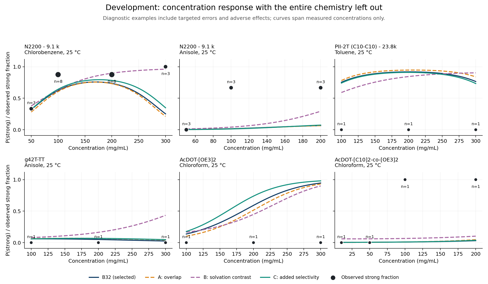
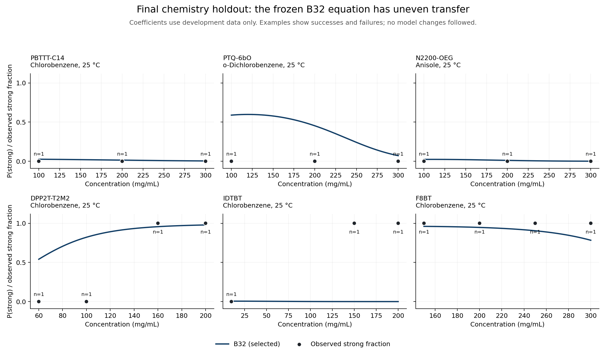

# Reasoning-driven equation repair: exploratory negative result

**The three allowed structural interventions did not produce a convincing improvement over B32.** We retained its five-term structure using development data only, froze that decision, evaluated the chemistry holdout once, and refitted the retained structure on all 773 observations. The complete fitted expression and units are in [FINAL_EQUATION.md](FINAL_EQUATION.md).

The inspiration was reasoning-guided intervention in an existing learned model. This study edits symbolic structure and then numerically fits coefficients; it is not direct neural-weight editing without optimization, nor a reproduction of the experiments in the [weight-space-programming article](https://rikiyat.github.io/blog/weight-space-programming/). No symbolic search, equation generator, hyperparameter grid, or polymer-specific offsets were used.

## Protocol and scope

The target is `abs_g_factor >= 0.001`. Before reading outcome rows, we split the 59 chemistry groups with NumPy `default_rng(20261104)`: randomly permute sorted group codes and reserve the first `ceil(0.2*59)=12`. Development contains **47 chemistries, 631 rows and 251 positives**; final holdout contains **12 chemistries, 142 rows and 20 positives**. Different observation counts per chemistry mean a 20.34% chemistry split holds aside 18.37% of rows. No stratification, seed selection, or redraw was performed.

Chemistries use the existing `chiral_sr.data.chemistry` function: identical polymer-constant descriptors, excluding Mn, Mw, PDI, temperature and concentration. It rounds floating descriptors to eight decimals, represents missing values consistently, concatenates them, and factorizes in first-observation order. The 61 defining columns are listed in `split.json`; the complete label-free mapping is in `split_manifest.csv`. This is a descriptor-defined equivalence, not a hand-curated claim about every constitutional isomer. It groups molecular-weight variants of N2200, PII-2T, PE2-biOE2OE3 and the ladder polymers. Every polymer name belongs wholly to one partition. No solvent or outcome descriptor appears in the chemistry key.

Held-aside codes: 4, 13, 15, 16, 19, 20, 32, 36, 48, 49, 57, 58, corresponding to PBTTT-C14, PTQ-2bO2, PTQ-6bO, PTQ-6O, N2200-OEG, p(C3NDI-T), DPP2T-T2M2, PyDPP-2T(C8C10), PM7 2ET2, TPT(alkyl)-E, IDTBT and F8BT. Development routines skip held-out worksheet rows when parsing metadata outcomes. `selection.json` was saved before `final_started.json`; the registry and fold definitions are hashed.

Each equation uses the repository's SyMANTIC `fit_glm` through `laws.fit`. Terms are centered and divided by their **training-fold sample SD**, then fitted with summed logistic loss plus `0.5*0.1*sum(beta²)`; the intercept is unpenalized. No class weighting, coefficient-sign constraints, missing-value imputation, offsets, or regularization tuning were used. All model terms are finite. First-order optimality was checked for every fit.

Primary assessment: **47-fold leave-one-chemistry-out (LOCO)**, with pooled out-of-fold predictions. Complement: the repository's **20 repetitions of five-fold stratified polymer-name–solvent grouped CV**, seeds 1000–1019, using 173 groups. The latter can share a chemistry across train and test, including molecular-weight variants, and is a weaker transfer test. All four models use exactly the same saved folds. Pooled scores weight observations; we also report equal-chemistry mean loss. Per-chemistry AP and AUC are undefined for single-class chemistries and are omitted there, not set to zero. Only 26 of 47 development chemistries have both classes.

## What was changed, and what feedback taught us

With notation defined in the final equation, B32 is

`f = b0 + b1(S−B)cR + b2HUFbb + b3c²Fbb/Q + b4(S−B)UB + b5cMB/E`.

At fixed descriptors this is quadratic in concentration. Its curvature changes sign at Fbb=0, which means 1 mol/L fragment solubility rather than a known assembly transition. Its positive linear Mn interaction is also not a universal overlap law. The development fit predicts decreasing probability at 244/631 observed conditions and misses low-M N2200/anisole positives while overpredicting several PII-2T conditions. These were development diagnostics, not evidence that all nonmonotonicity is unphysical.

Every proposal and expected behavior was recorded in `EXPERIMENT_LOG.md` before its first fit. The entire budget was three proposals:

| Model | Structural intervention | Terms | Feedback |
|---|---|---:|---|
| A_overlap | Replace cMB/E with c sqrt(M/1000) B/E | 5 | Ideal-coil overlap scaling weakened MW dependence but did not repair N2200 and worsened LOCO performance. |
| B_contrast | Restore original Mn term; replace c²Fbb/Q with c²(Fbb−Fmono)/Q | 5 | A relative-solubility zero is more interpretable, but removing absolute backbone solubility lost substantial information. |
| C_selectivity | Restore all B32 terms; add c(Fmono−Fbb) | 6 | The expected negative interaction appeared, but predictive gains were too small and inconsistent to justify the added term. |

A's overlap analogy assumes ideal-coil size scaling and need not apply to semiflexible chains in concentrated solutions. B tests solvent selectivity as a substitute for absolute fragment solubility. C instead treats selectivity as a leading-order concentration correction. Neither solubility descriptor is a measured polymer assembly free energy. These are distinct, bounded scientific hypotheses, not claims of derived physical laws.

## Development results

Higher AP/AUC and lower loss are better. Complementary scores are means of 20 pooled-OOF repeats, not scores of predictions averaged across repeats.

| Model | LOCO AP | LOCO AUC | LOCO log loss | Equal-chemistry loss | Pair-CV AP | Pair-CV AUC | Pair-CV log loss |
|---|---:|---:|---:|---:|---:|---:|---:|
| **B32 (selected)** | 0.786868 | 0.863834 | **0.447150** | **0.381987** | 0.792941 | 0.869314 | **0.439066** |
| A_overlap | 0.777791 | 0.860951 | 0.454579 | 0.384271 | 0.791480 | 0.870571 | 0.440238 |
| B_contrast | 0.693110 | 0.800068 | 0.530354 | 0.438790 | 0.719983 | 0.817950 | 0.506435 |
| C_selectivity | 0.788254 | **0.865218** | 0.448768 | 0.394483 | **0.794184** | **0.871085** | 0.441296 |

Pair-CV AP standard deviations across repeats are respectively 0.010969, 0.011163, 0.011057 and 0.011763; loss SDs are 0.011495, 0.010552, 0.009046 and 0.012627. Repeats share observations and are not independent experimental replicates. Equal-weight AP across the 26 mixed-class chemistries is 0.86543, 0.86633, 0.83674 and 0.86539 respectively; corresponding AUCs are 0.86089, 0.86114, 0.83566 and 0.86038. These conditional averages exclude single-class chemistries and cannot replace all-chemistry loss.

Paired percentile intervals below resample entire development chemistries 2,000 times (seed 20261105), using the same fixed OOF predictions for each model. They describe sensitivity to chemistry composition, **not** fully nested selection-adjusted generalization uncertainty.

| Candidate minus B32 | Δ LOCO AP [95% interval] | Δ LOCO loss [95% interval] | Chemistries with lower loss |
|---|---|---|---:|
| A | −0.00908 [−0.03537, 0.01471] | +0.00743 [−0.01128, 0.02400] | 25/47 |
| B | −0.09376 [−0.15921, −0.03844] | +0.08320 [0.03929, 0.12798] | 13/47 |
| C | +0.00139 [−0.02208, 0.01812] | +0.00162 [−0.01395, 0.01839] | 32/47 |

C's chemistry-median loss change was −0.00659, and its selectivity coefficient was negative in every LOCO fit (range −0.004304 to −0.001171). But its larger adverse changes included AcDOT-[OE3]2 (+0.500 loss), D18 (+0.266), ProDOT(OE3)-co-ProDOT(EtHx) (+0.213) and PE2-biOE2 (+0.204). Its equal-chemistry loss worsened by 0.01250. Complementary AP improved in 15/20 repeats, while loss improved in only 4/20. The small pooled Brier improvement (0.146956 to 0.146918) likewise provides little support for added complexity. Training AP improved from 0.81920 to 0.82510, which is insufficient evidence of transfer.

**Selection: retain B32.** It has one fewer term than C, better pooled and macro LOCO log loss, and essentially tied ranking performance. This decision was frozen before final holdout evaluation. There was no holdout-based model or threshold selection.

Figure 1 uses the fit that excludes the entire displayed chemistry. Points are the measured fraction with |g|≥10⁻³ at exactly matched polymer, solvent, temperature and concentration; labels show the replicate count. Curves cover measured concentration ranges. These deliberately diagnostic examples show targeted failures and adverse effects, not a representative random sample. No uncertainty bands are asserted for the small and correlated replicate counts. Raw g factors remain available in the prediction CSV.

## Final held-aside assessment

The selected model **is B32**, so these two requested roles have identical predictions and are evaluated once, not treated as two independent models. Rejected A, B and C were not evaluated on the holdout.

| Frozen development fit | AP | ROC-AUC | Log loss | Brier |
|---|---:|---:|---:|---:|
| Original B32 = selected structure | 0.655716 | 0.759426 | 0.484564 | 0.103313 |
| Chemistry-bootstrap 95% interval | [0.257835, 0.941539] | [0.440315, 0.994174] | [0.159306, 1.233610] | [0.037788, 0.216481] |

Intervals use 2,000 fixed-prediction resamples of the 12 holdout chemistries, with both classes in all draws. They are very wide. Holdout prevalence is 0.14085 versus 0.39778 in development, so absolute AP and Brier values across the two partitions are not directly comparable measures of degradation. At the untuned P≥0.5 cutoff, 13/20 positives were detected and 10/122 negatives were called strong.

Equal-chemistry holdout log loss is **0.96989**, much worse than the row-weighted 0.48456. PBTTT-C14 contributes 51 easy all-negative observations; IDTBT contributes only three but has loss **7.52761** and AUC 0.0, with two positive observations assigned probabilities near zero. N2200-OEG has loss **1.22261** and AUC 0.5; its positive chlorobenzene and o-dichlorobenzene conditions at 300 mg/mL receive P≈0.00269 and 0.00175. F8BT's six positives are better represented (loss 0.13324). Every chemistry's results are in `holdout_B32_per_chemistry.csv`; the failures were not used for another revision.

Figure 2 uses development-fitted coefficients throughout. Displayed holdout series illustrate heterogeneous behavior, including the severe IDTBT failure; they were selected for description after evaluation. The N2200-OEG anisole panel shows a correctly negative 25 °C series, not its failures in other solvent/temperature conditions.

## Physical lessons, limitations and conclusion

The final all-data equation retains a positive MW effect and a solvent-dependent quadratic concentration response. A plausible story about overlap or selective solvation is not enough to justify changing an empirical equation: A and B demonstrate that directly. C's stable negative contrast effect is an interesting conditional association, but its unequal gains and losses do not establish predictive utility or the proposed mechanism. B32's stable signs across LOCO folds likewise do not confer causal meaning.

Concentration downturns can represent competing aggregation pathways, but B32 forces their asymptotic direction through the numerical sign of fragment log solubility and gives nonzero dilute-limit probabilities. It omits explicit temperature dependence, dispersity and preparation history, and cannot predict handedness or g-factor magnitude. There are 496 distinct development descriptor/chemistry conditions; 13 have both binary labels, spanning 46 observations. At least 13 labels therefore cannot be classified correctly by any deterministic threshold on these identical inputs. Retained measurement repeats are correlated and should not be mistaken for independent chemical coverage.

**Evaluation caveats:** B32's original structure was discovered on all 773 observations, so neither the LOCO results nor the new holdout are independent of its discovery. The three adaptively evaluated proposals also reuse development folds, without an outer selection CV. Chemistry groups are descriptor based, and chemically related groups can lie across the split. In addition, a broad background literature search during development returned a published DPP-T2M2 concentration/chirality example, a held-aside chemistry. It was not used as numerical feedback or a selection criterion, and workbook holdout outcomes remained excluded until freezing, but blindness to external published information was imperfect. That exposure is recorded in the chronological log. These limitations preclude a pristine prospective-generalization claim.

This experiment supplies **no credible positive evidence that the attempted reasoning-driven equation edits improved this problem**. It does show that bounded hypotheses can be formulated, tested, and rejected reproducibly without hiding unfavorable evidence. It cannot determine whether reasoning-driven editing is generally useful: there is one dataset, one inherited structure, three proposals, and no matched random-edit/search control. New concentration/MW series and matched-solvent tests described in `FINAL_EQUATION.md` would be more informative than another round of fitting to these same labels.

## Reproducibility

Run `.venv/bin/python experiments/astra_equation_repair/reproduce.py` from the repository root. It reconstructs the split, checks source hashes, refits all **588 development folds**, verifies scores and final coefficients, evaluates the equation printed in `FINAL_EQUATION.md`, and cross-checks the final fit with SciPy BFGS initialized at zero. All development logits reproduced exactly. The printed equation's maximum probability error was 2.22×10⁻¹⁵, and the independent optimizer agreed within 5.68×10⁻¹⁰. The saved single holdout prediction vector is used to verify its reported metrics; no rejected structure is tested there. Numerical tolerances and measured differences are in `verification.json`. Both figures were rendered and visually inspected. See `README.md` for the staged original commands and artifact map.
